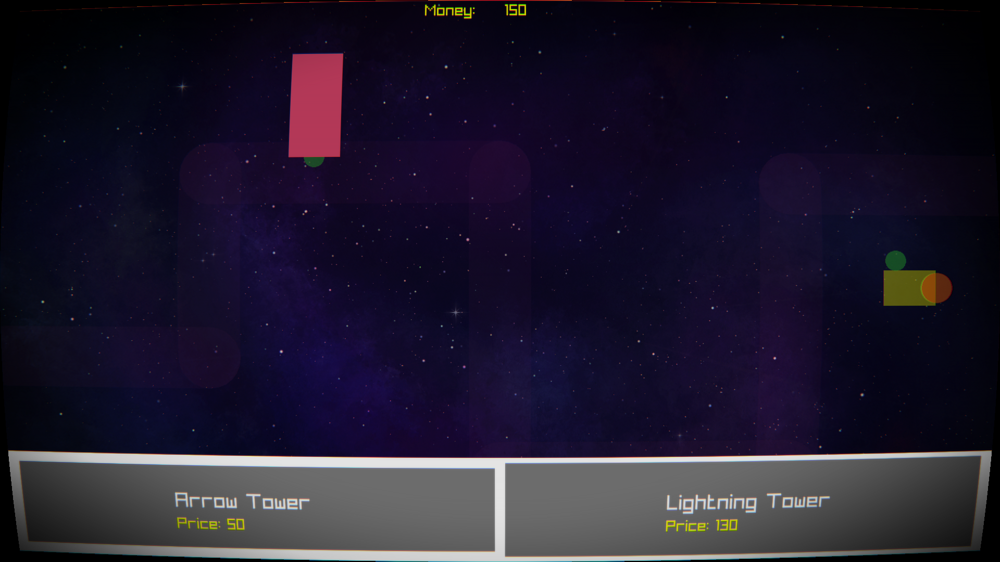

# labyrinth Survivor
&emsp;2D top down-tower defense game.

## Description
&emsp;Game made in C using raylib with CMake as the build tool.
### Note
If you play the game, go into the borders of the arena ;)
### Idea
You are in a space labyrinth and have to protect your lost ship and multiple waves of enemies trying to raid it, you have to strategically drive your player in the no friction arena into borders that repel you into positions you might or might not like.

## Building and Running
* You need cmake 3.11 or newer installed to build the project, run the following cammand to see what version you have installed if any:
```bash
cmake --version
```
* Raylib is required to build and compile this project, if you have raylib installed in your system run the following:
```bash
cmake -S . -B build
cmake --build build
```
* If raylib is not installed in your system, run the following command to automatically download and compile raylib for the project:
```bash
cmake -S . -B build -DFETCH_DEPENDENCIES=ON
cmake --build build
```

* After successfully building, you can find the executable inside the build folder labeled "build", you can run it in your file manager or by running the following in your terminal while in the parent directory:
```bash
./build/survivor
```

### Dependencies
- Linux operating system (Never tested on windows or macos)
- Raylib
- X11 and Wayland (idk which one you need so you need both ig)

### ScreenShots


## License

Copyright (c) 2026 lokk. All rights reserved.

This project is licensed under the Elastic License 2.0 - see the [LICENSE](LICENSE) file for details.
